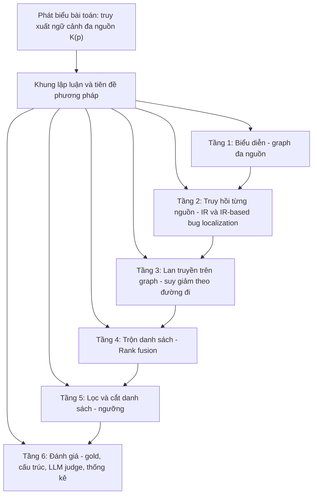

# Hệ thống cơ sở lý thuyết của đề tài RepoGraph

Tạo ngày 03/11/2026.

Nguồn tổng hợp: `research_context.md`, `planning.md`, `pipeline_design.md`, `thesis_knowledge.md`, `coverage_report.md`. File này không dùng `experiment_log.md`. Khi file này và các file nguồn khác nhau, file nguồn là nguồn đúng.

Mỗi khối lý thuyết ghi: khái niệm, công thức, bài báo làm cơ sở, mức đã đọc (theo cột "Đã đọc" của `thesis_knowledge.md`), và chỗ chưa có cơ sở.

---

## 0. Cấu trúc tổng thể

---

## 1. Bài toán và khung lập luận

### 1.1 Phát biểu bài toán
*Nguồn: `research_context.md` mục 1, 12; `planning.md` mục 1; `thesis_knowledge.md` mục 1.*

- **Input:** một prompt `p` trên repository (issue, câu hỏi, yêu cầu tìm code/doc). Use case được đo: issue của SWE-bench (split test, 12 repo, 2.294 instance).
- **Output:** tập ngữ cảnh đa nguồn `K(p)` ghép theo loại:
  1. Danh sách hàm/lớp xếp theo khả năng phải sửa (đo bằng gold).
  2. Các node bằng chứng (DocChunk, commit/hunk, báo cáo lỗi cũ), đo bằng LLM judge.
- **Câu hỏi trung tâm:** dữ liệu đa nguồn (AST + DOC + HIST + ISSUE) có định vị code tốt hơn chỉ dùng code (AST) không. Mọi kết quả so với AST, đo bằng tác động khi thêm nguồn vào AST.

| Nguồn | Thông tin kỳ vọng | Cơ sở lý thuyết chính |
|---|---|---|
| AST | Mốc chỉ dùng code | Hybrid retrieval (BM25 + dense + RRF) |
| DOC | Hành vi mong đợi, cách dùng API | KGCompass (sau hop); chưa có bài cho cách bỏ phiếu cũ |
| HIST | Vùng code từng đổi, vì sao đổi | Locus, AmaLgam, HAFix |
| ISSUE | Lỗi tương tự, nơi đã sửa | BugLocator |

### 1.2 Tiên đề của khung lập luận
*Nguồn: `research_context.md` mục 2, quyết định 17, 20, 57, 58.*

| # | Tiên đề | Hệ quả phương pháp |
|---|---|---|
| T1 | Doc có đủ thông tin để tạo tác động dương. Tác động âm là lỗi phương pháp; thông tin trùng thì tác động bằng 0 | Nhãn loại trừ `no_new_information`; nguồn âm phải điều chỉnh phương pháp, không bỏ nguồn |
| T2 | "Tổng thể": doc không cần giúp mọi issue, chỉ cần giúp khi xét chung | Đo trung bình trên tập, có phân tầng theo độ khó |
| T3 | LLM chỉ là judge, không tạo xếp hạng | Toàn bộ xếp hạng là IR cổ điển + graph |
| T4 | Mọi quyết định kỹ thuật phải có bài báo làm cơ sở; số đo của đề tài chỉ bổ sung | Bảng tham số ghi cột "Cơ sở" (`pipeline_design.md` mục 12) |
| T5 | Không huấn luyện model nên không chọn tham số trên dữ liệu, không chia dev/test | RRF gốc k = 60; tham số giữ nguyên từ bài (Locus, KGCompass) |
| T6 | Kế hoạch phân tích viết trước khi xem kết quả; không đổi phương pháp đã chốt vì kết quả xấu | Tiêu chí đặt trước cho G1, C1/C2 |
| T7 | Commit phải được đọc cùng diff | Locus dùng hunk làm tài liệu (xem mâu thuẫn ở mục 8) |

---

## 2. Tầng biểu diễn: graph đa nguồn

*Nguồn: `pipeline_design.md` mục 2; `research_context.md` mục 4.1, 9.3; `thesis_knowledge.md` mục 2.4, 3.*

| Nhóm | Node | Cạnh | Cơ sở |
|---|---|---|---|
| Code | Module, Class, Function | `Defines`, `Imports`, `Calls` (heuristic), `Inherits` | Khảo sát hệ graph cho code: RepoGraph (ozyyshr), CodeFuse CGM, Prometheus, CodexGraph, LocAgent. **Thiết kế cụ thể chưa có bài** |
| Doc | Document, DocChunk (theo heading RST, ≤ 1.600 ký tự) | `HasChunk`, `Documents` (role/directive Sphinx, theo module ngữ cảnh), `References` (`:doc:`) | **Chưa có bài**; số liệu do đề tài đo |
| History | Commit, Issue | `Modifies` (mang diff hunk), `Fixes` | Abedu, Khatoonabadi, Shihab (TOSEM, toàn văn); KGCompass (toàn văn) |

**Vai trò lý thuyết của graph** (quyết định 31): đưa vào kết quả node mà search không với tới; ưu tiên node bằng chứng có liên kết với AST node đã truy hồi; AST node hop ra node khác.

**Snapshot** (`research_context.md` 4.2): khoảng 60 ngày, build tại base commit sớm nhất → đảm bảo không instance nào thấy bản sửa của instance khác. **Chưa có bài**; là phép xấp xỉ chi phí.

**Gold và oracle** (`pipeline_design.md` mục 3): dòng đổi gán cho hàm/lớp hẹp nhất chứa nó; Gold, touch set của HIST và Fix(b′) của ISSUE dùng chung `get_oracle`. **Chưa có bài**; ghi là mối đe dọa (lỗi chung của oracle làm các nguồn trông tốt hơn).

---

## 3. Tầng truy hồi từng nguồn

### 3.1 Nền tảng truy hồi thông tin
*Nguồn: `thesis_knowledge.md` mục 2.1; `pipeline_design.md` mục 4.*

| Khái niệm | Công thức / tham số | Dùng ở | Cơ sở | Đã đọc |
|---|---|---|---|---|
| Vector space TF-IDF | $w_{td} = (\log f_{td} + 1)\cdot \log(N/n_t)$, cosine | HIST (NL, CE), ISSUE, `hist-msg` | Locus; rVSM của BugLocator | Locus toàn văn; BugLocator thứ cấp |
| BM25 | `BM25Okapi`, k1 = 1,5, b = 0,75 | AST, chunk doc | Mặc định `rank_bm25` | **Chưa có bài** |
| Dense retrieval | `bge-small-en-v1.5`, cosine | AST (Function/Class), DOC | | **Chưa có bài** |
| Thang điểm | Cosine có thang cố định → đặt được ngưỡng tuyệt đối; BM25, RRF không | Ngưỡng (mục 6) | | |

**AST (mốc chỉ dùng code):** 500 node đầu của BM25 và của embedding, gộp bằng RRF ($\sum 1/(60+r)$), giữ 500 hàm/lớp. Chỉ k = 60 có cơ sở (Cormack 2009); phần còn lại là thiết kế từ v2.

### 3.2 Định vị lỗi dựa trên truy hồi (IR-based bug localization)
*Nguồn: `thesis_knowledge.md` mục 2.2; `pipeline_design.md` mục 6, 6b, 7.*

**HIST theo Locus** (Wen, Wu, Cheung, ASE 2016 — toàn văn). Tài liệu là hunk:

$$\text{score}(b,f) = \max_{h \in H(f)}\{\text{NL}(b,h) + \alpha\cdot\text{CE}(b,h)\} + \beta_1\cdot\text{Fix}(f)$$

$$\alpha = \min\left(1, \lambda\cdot\frac{\#\text{tên code trong issue}}{\#\text{token issue}}\right),\quad \text{Fix}(f) = \sum_i \frac{1}{1+e^{-12 t_i + 12}}$$

với λ = 5, β₁ = 0,1. Lập luận của bài: hunk tốt hơn cả file (MAP 0,382 → 0,630), CE +23,6% MAP. Quy tắc `fix|bug` theo AmaLgam (toàn văn).

Bảy chỗ chuyển đổi sang mức hàm/lớp (A1–A7, `pipeline_design.md` 6.4) **không có trong bài**:

| Mã | Chuyển đổi | Lập luận |
|---|---|---|
| A1 | File → hàm/lớp, đại diện bằng hunk tốt nhất | Áp nguyên quy tắc max của Locus |
| A2 | Commit sửa lỗi khớp `fix\|bug` | AmaLgam ghi rõ |
| A3 | t = 0 ở đơn vị cũ nhất, t = 1 ở `created_at` | SWE-bench không có ngày phát hành |
| A4 | Chỉ hunk của commit là tổ tiên snapshot; IDF theo snapshot | Chống rò rỉ chặt hơn bài |
| A5 | Chỉ `.py`, `git diff -w`, bỏ hunk chỉ đổi comment | Theo Locus |
| A6 | Query là `problem_statement` | Tương tự việc Locus bỏ thảo luận |
| A7 | Heuristic nhận từ giống code | Locus dẫn Meng và cộng sự, không ghi chi tiết; **bỏ sót tên lớp chỉ hoa chữ đầu** |

**HIST theo phần lời commit (`hist-msg`)** (`pipeline_design.md` 6b, `planning.md` 6.18.3). Lập luận: HIST nên cung cấp phần lời (vì sao sửa, cái gì hỏng), còn tìm code là việc của AST; Locus/CE "làm lại việc của AST".

$$s(c) = \frac{1}{60 + r_{\text{lời}}(c)} + \frac{1}{60 + r_{\text{AST}}(c)},\qquad \text{score}(f) = \max_{c \ni f} s(c)$$

Cơ sở: Locus (message chia sẻ từ với báo cáo lỗi nhiều hơn code), HAFix/HAFixAgent (diff thô thường làm kém với model nhỏ; chọn commit theo vùng code bị nghi), RRF gốc. **Việc ghép message với ticket/PR, dùng hạng AST làm danh sách thứ hai, và xếp hòa theo commit mới hơn là đề xuất của đề tài, chưa có bài.**

**ISSUE theo BugLocator** (Zhou, Zhang, Lo, ICSE 2012 — mới đọc qua nguồn thứ cấp):

$$\text{SimiScore}(f) = \sum_{b' :\, f \in \text{Fix}(b')} \frac{\text{sim}(b, b')}{|\text{Fix}(b')|}$$

Không có ngưỡng tương đồng; trọng số tốt nhất trong bài 0,2–0,3 (đề tài không dùng vì trộn RRF trọng số 1).

**Tách theo issue nêu sẵn tên gold:** Kochhar, Tian, Lo (ASE 2014) và bản làm lại của Widyasari (tóm tắt) — báo cáo nêu sẵn vị trí làm định vị dễ hơn.

### 3.3 Lịch sử phiên bản, liên kết issue–commit và chống rò rỉ
*Nguồn: `thesis_knowledge.md` mục 2.3; `pipeline_design.md` mục 6.1, 7.*

- **Đơn vị commit:** commit nhánh chính (`git log --first-parent`).
- **Liên kết:** Django "Fixed #N" (bỏ "Refs #N", quyết định 50); GitHub: từ khóa đóng issue, merge/squash PR.
- **ROSE** (Zimmermann, ICSE 2004, toàn văn): bỏ transaction chạm > 30 thực thể → cơ sở cho `HIST_MAX_TOUCH = 50` và phép chia $|\text{Fix}(b')|$.
- **Sisman và Kak** (MSR 2012, qua patent): tiên nghiệm giảm theo hàm mũ thời gian → không dùng cửa sổ cứng.
- **Chống rò rỉ theo thời gian:**

| Bằng chứng trong tài liệu | Mức đọc | Áp dụng |
|---|---|---|
| Tái lập ABLoTS (2026): dùng đúng ngày báo cáo, MAP 0,488 → 0,055 | Toàn văn phần chính | Động cơ cho chống rò rỉ chặt |
| KGCompass: chỉ giữ artifact trước `created_at` (loại 24%) | Toàn văn | Mốc cắt ISSUE |
| Lingxi: lọc kho issue cũ theo thời gian | | Mốc cắt ISSUE |
| SWE-bench issue #465: agent đọc bản sửa tương lai qua `git log --all` | | `--first-parent` + tổ tiên |

Đề tài dùng **điều kiện tổ tiên của snapshot** (chặt hơn lọc thời gian) và mốc cắt ISSUE là thời điểm tạo báo cáo của chính instance, đệm 1 ngày (quyết định 44).

---

## 4. Tầng lan truyền trên graph

*Nguồn: `pipeline_design.md` mục 5, 8b; `thesis_knowledge.md` mục 2.4; quyết định 59.*

**Động cơ lý thuyết.** HippoRAG (NeurIPS 2024, toàn văn phần chính): mở rộng hàng xóm không suy giảm kém hơn chỉ dùng node gốc (R@2 42,2 so với 50,7); PPR restart 0,5 đạt 57,4; specificity $s = 1/|P_i|$ giúp thêm. → Cách bỏ phiếu cũ `vote_ast` (nhân 0,8, lan 0,5, trần 20 hàng xóm) **không có cơ sở** và bị thay.

**Công thức KGCompass** (arXiv 2503.21710, phương trình 1 — toàn văn phần công thức; code công khai cho trọng số cạnh):

$$S(f) = \beta^{l(f)} \times \left(\alpha\cdot\frac{\cos + 1}{2} + (1-\alpha)\cdot \text{lev}\right),\quad \text{lev} = 1 - \frac{d_{\text{Lev}}(a,b)}{\max(|a|,|b|)}$$

β = 0,6, α = 0,3, ngân sách l ≤ 4; l(f) là đường ngắn nhất (Dijkstra).

| Cạnh | Trọng số | Cơ sở |
|---|---|---|
| Issue → node xuất phát, `Defines`, module → method | 0,25 | Code KGCompass |
| `Documents` | 0,5 | Code KGCompass (tham chiếu giải bằng tên) |
| `Calls` | 1,0 | Code KGCompass |
| `Inherits` | 1,0 | LocAgent xếp kế thừa chung nhóm với lời gọi |
| `Imports` | không dùng | KGCompass không có |

**Phả hệ lý thuyết của công thức:**
- Zhu và Iglesias (TKDE 2017, toàn văn phần phương pháp): wpath = 1/(1 + length·k^IC), **dạng nghịch đảo**, không phải mũ. Dạng mũ $\beta^l$ gần Li và cộng sự ($e^{-0,2\cdot\text{length}}$).
- Ballatore và cộng sự (ISPRS IJGI 2015, toàn văn): cộng tuyến tính độ giống cấu trúc và văn bản, α tốt nhất ≈ 0,5 — **giá trị 0,3 không đến từ bài này**.
- Hai bài chỉ cho ý tưởng, không cho dạng hàm hay giá trị; β, α do tác giả KGCompass chọn trên SWE-bench.

**Hai danh sách:** GRAPH (xuất phát từ 10 node đầu AST; số 10 lấy theo k lớn nhất của độ đo Renieris và Reiss — **chưa có bài Graph RAG cố định số này**); DOC `doc_kgc` (xuất phát từ đích `Documents` của 10 chunk).

---

## 5. Tầng trộn danh sách

*Nguồn: `pipeline_design.md` mục 8; `thesis_knowledge.md` mục 2.1; quyết định 46, 57.*

**RRF gốc** (Cormack, Clarke, Büttcher, SIGIR 2009 — toàn văn):

$$\text{score}(d) = \frac{1}{60 + r_{\text{AST}}(d)} + \sum_{s}\frac{1}{60 + r_s(d)}$$

Mọi danh sách trọng số 1, không giữ cố định đầu AST, không tham số chọn trên dữ liệu (T5). Phân tích hàm trộn: Bruch, Gai, Ingber (TOIS 2023, đọc phần chính).

**Giới hạn lý thuyết đã ghi:** bài của Cormack không thử trộn một danh sách mạnh với các danh sách yếu hơn nhiều. Với RRF trọng số bằng nhau, một nguồn yếu có lá phiếu ngang AST.

**Lịch sử quyết định:** `fused_multi` của v3 (tham số p, h — lưới chưa có cơ sở) → RRF có trọng số chọn bằng kiểm định chéo (quyết định 46) → RRF gốc (quyết định 57, vì chọn trọng số trên chính dữ liệu vi phạm T5).

---

## 6. Tầng lọc: ngưỡng và cắt danh sách

*Nguồn: `thesis_knowledge.md` mục 2.5; `research_context.md` mục 12; quyết định 32.*

**Quyết định:** dùng ngưỡng thay số lượng cố định ở ba vị trí (trước hop, trước vote, trước output). **Cách chọn ngưỡng chưa chốt.**

| Nhóm lý thuyết | Bài | Ý chính |
|---|---|---|
| Ngữ cảnh nhiễu hại LLM | The Power of Noise (Cuconasu, SIGIR 2024); Gu và cộng sự (arXiv 2503.20589) | Tài liệu giống câu hỏi nhưng không chứa đáp án làm độ chính xác giảm tới 0,24; code tương tự làm Pass@1 37,75 → 29,86 |
| Cắt không giám sát | Adaptive-k (EMNLP 2025); Arampatzis, Kamps, Robertson (SIGIR 2009); Surprise (arXiv 2010.09797) | Cắt tại khoảng rơi lớn nhất; hỗn hợp phân bố tối ưu F1 có phương án rỗng; điểm bất ngờ theo GPD |
| Cắt có giám sát | Choppy (SIGIR 2020); Meng và cộng sự (SIGIR 2024) | Chỉ hơn fixed-k một ít, hiếm khi dự đoán "không cần gì" → **fixed-k là mốc phải so** |
| Ngưỡng trên graph | Push PageRank (Andersen, Chung, Lang, FOCS 2006); G-Retriever | Lan tiếp khi r(u) ≥ ε·d(u); PCST với chi phí cạnh |

Khoảng trống: chưa bài nào trong tài liệu đã đọc dùng ngưỡng cosine tuyệt đối làm phương pháp chính.

---

## 7. Tầng đánh giá

### 7.1 Đánh giá theo gold (phần AST)
*Nguồn: `research_context.md` mục 13.1; `pipeline_design.md` mục 10.*

| Độ đo | Cơ sở |
|---|---|
| Top@1/5/10 (any-gold), MAP | Locus, AmaLgam (toàn văn) |
| MRR | Locus |
| Acc@k (mọi gold trong top k) | LocAgent, SweRank (tóm tắt), MULocBench (toàn văn phần độ đo) |
| Hai mức: hàm/lớp (chính), file (phụ, điểm file = max điểm hàm/lớp) | SweRank |

Hạng tính tới 500.

### 7.2 Độ đo theo cấu trúc (`depth-v4`)
*Nguồn: `pipeline_design.md` 10.1; quyết định 53.*

Số node phải đọc: người đọc lý tưởng đọc top k, rồi mở rộng theo lớp BFS trên `Calls`, `Inherits`, `Defines`; vị trí kỳ vọng trong lớp cuối là $(n+1)/(g+1)$.

| Bài | Vai trò | Đã đọc |
|---|---|---|
| Renieris và Reiss (ASE 2003) | Chấm theo phần chương trình người dùng lý tưởng không phải xem khi đi dần trên graph phụ thuộc | Chưa đọc toàn văn |
| Cleve và Zeller (ICSE 2005) | Dùng lại cách chấm | Chưa đọc toàn văn |
| Parnin và Orso (ISSTA 2011) | Số tuyệt đối có ý nghĩa hơn phần trăm; developer không đọc tuần tự | Chưa đọc toàn văn |

### 7.3 LLM judge cho bằng chứng
*Nguồn: `research_context.md` mục 13.2–13.3; `pipeline_design.md` mục 9; `planning.md` 6.18.*

**Lý thuyết "hữu ích" thay vì "liên quan":**
- eRAG (Salemi, Zamani, SIGIR 2024, toàn văn): nhãn "liên quan" do LLM chấm gần như không tương quan với kết quả cuối (Kendall τ −0,04 đến 0,19).
- Utility judgments (Zhang và cộng sự, SIGIR 2024, toàn văn phần chính): hỏi "hữu ích" tốt hơn (F1 +30,98% trên NQ); chấm theo danh sách tốt hơn; **LLM nhạy với vị trí** → xáo thứ tự theo seed.
- Thomas và cộng sự (SIGIR 2024, tóm tắt): nhãn LLM chính xác khi prompt được chọn theo phản hồi thật.
- Chiang và Lee (Findings EMNLP 2023): bắt giải thích giúp khớp người chấm — nhưng thử trên model không thinking; ảnh hưởng của việc bỏ lý do **chưa được đo**.

**Hệ phân loại loại thông tin** (quyết định 40):

| Loại | Cơ sở |
|---|---|
| Hành vi mong đợi | Ko, DeLine, Venolia (ICSE 2007); Bettenburg (expected behavior) |
| Cách dùng API | Ko |
| Triệu chứng lỗi tương tự | Ko; Bettenburg (observed behavior, stack trace) |
| Nguyên nhân lỗi | Ko |
| Vị trí code liên quan | Ko |
| Lý do thiết kế | Ko |
| Thay đổi trước đây | Ko; Locus, HAFix |
| Không có thông tin mới (loại trừ) | Tiên đề T1 |
| Không liên quan (loại trừ) | |

**Thiết kế pool:** chấm một pool 10 phần tử đầu mỗi loại một lần; mọi ngưỡng chỉ giữ một phần pool nên đánh giá ngoại tuyến được mọi ngưỡng. Hữu ích khi điểm ≥ 2.

**Độ đo cắt danh sách bằng chứng:**
- Precision, Recall trong pool, F1 dạng micro (Bacchelli, Lanza, Robbes, ICSE 2010).
- T11U = 2·TP − FP (Robertson và Soboroff, TREC 2002 Filtering).
- Bảng 2×2 rỗng/không rỗng × pool có/không có phần tử hữu ích.
- Mốc: hạn ngạch cố định (Meng 2024).

**Đủ thông tin cho cả tập:** Sufficient Context (Joren, ICLR 2025) — nhãn nhị phân cho K(p), chỉ cho Q4. **Chưa làm.**

**Kiểm tra nhất quán của judge bằng tín hiệu khách quan** (`thesis_knowledge.md` 2.6): so nhãn hữu ích với việc phần tử nối tới gold; theo Faggioli (ICTIR 2023), Thomas (2024). Nối nhãn phần tử với kết quả cuối theo eRAG và The Power of Noise. Bổ sung giữa nguồn theo Zou (TSE 2021). Theo vị trí theo Järvelin và Kekäläinen (TOIS 2002). **Faggioli, Zou, Järvelin chưa đọc.**

### 7.4 Kiểm định thống kê
*Nguồn: `research_context.md` mục 13.4.*

| Phép | Dùng cho | Cơ sở |
|---|---|---|
| McNemar chính xác | Top@k, Acc@k | |
| Hoán vị ghép cặp (10.000) | MRR, MAP, số node phải đọc, P/R/F1 | Smucker, Allan, Carterette (CIKM 2007); Urbano, Lima, Hanjalic (SIGIR 2019): t-test và permutation giữ đúng sai số loại I, Wilcoxon/sign test thì không |
| Holm trong từng độ đo, theo họ (Q1–Q7; G1–G2; C1–C2) | | |

Giới hạn: coi instance độc lập dù chung snapshot, doc, history. Bootstrap theo khối snapshot có trong thuật ngữ nhưng **không dùng** trong `verify-v4`.

### 7.5 Độ phủ doc như một biến
*Nguồn: `research_context.md` 13.6; `pipeline_design.md` 10.2; `coverage_report.md`; quyết định 60.*

| Thành phần | Cơ sở |
|---|---|
| C1: Spearman ρ giữa độ phủ repo và Δ (hoán vị nhãn repo) | Cronen-Townsend, Zhou, Croft (SIGIR 2002, đọc đoạn phương pháp) |
| C2: hiệu Δ giữa nhóm gold có/không có doc (hoán vị trong từng repo) | Kochhar (ASE 2014); Gelman và Stern (2006); Wang (NEJM 2007) |
| Đối chứng âm +HIST, +GRAPH | Lipsitch, Tchetgen Tchetgen, Cohen (Epidemiology 2010) |
| Không cắt biến liên tục thành hai nhóm (bỏ ngưỡng 5%) | Altman và Royston (BMJ 2006) |

Giới hạn: 12 repo trải 0,2%–24,0%, đầu cao chỉ có flask (11 instance); chưa bài nào đã đọc đo quan hệ độ phủ doc do người viết với định vị lỗi không dùng LLM (RepoRepair dùng doc do LLM sinh và định vị bằng LLM).

---

## 8. Khoảng trống và mâu thuẫn trong chính các tài liệu

### 8.1 Thành phần chưa có bài báo làm cơ sở (vi phạm T4)

| Thành phần | Nơi ghi |
|---|---|
| Snapshot 60 ngày | `pipeline_design.md` mục 1 |
| Thiết kế graph code, cách nối `Documents`, chunk 1.600 ký tự | mục 2 |
| Oracle `get_oracle` | mục 3 |
| BM25 + embedding của AST, độ sâu 500, cắt 2.000/8.000 ký tự | mục 4, 12 |
| `vote_ast` (0,8; 0,5; 20) — đã thay bằng `doc_kgc` | mục 5 |
| Bảy chuyển đổi A1–A7 của Locus | mục 6.4 |
| Phần ghép lời commit + ticket/PR và danh sách nối AST của `hist-msg` | mục 6b |
| Số node xuất phát 10 của GRAPH; cạnh `Inherits` = 1,0 (suy từ LocAgent) | mục 8b |
| Cạnh và độ sâu tối đa 3 của `depth-v4` | mục 10.1, 12 |
| Cách chọn ngưỡng | `thesis_knowledge.md` 2.5 |
| Hoán vị giới hạn trong từng repo | `pipeline_design.md` 10.2 |
| Số instance chấm lặp 130 | mục 12 |

### 8.2 Bài được dẫn nhưng chưa đọc đủ
BugLocator (thứ cấp — trong khi là công thức chính của ISSUE), Renieris và Reiss, Cleve và Zeller, Parnin và Orso, Kochhar, Widyasari, LocAgent/SweRank (tóm tắt), Thomas (tóm tắt), Faggioli, Zou, Järvelin và Kekäläinen, BM25 và dense retrieval (chưa có bài). Cormack 2009 và Cuconasu 2024 chưa có link trong tài liệu.

### 8.3 Mâu thuẫn giữa các file

| # | Mâu thuẫn | Vị trí |
|---|---|---|
| M1 | Tiên đề T7 "commit phải đọc cùng diff" ↔ judge v5 và `hist-msg` bỏ diff khỏi phần tử HIST (theo HAFix) | `research_context.md` mục 2 ↔ `planning.md` 6.18, `pipeline_design.md` 9 |
| M2 | `research_context.md` 4.3 ghi phiếu DOC lan qua `Calls`; code lan theo mọi cạnh AST chiều xuôi | `pipeline_design.md` mục 5 (Lưu ý) |
| M3 | Precision/Recall/F1 tính theo từng instance rồi trung bình ↔ dạng micro từ 29/10 | `research_context.md` 13.2 ↔ `pipeline_design.md` 10 |
| M4 | Kiểm định "Holm trên 7 câu hỏi" ↔ Holm theo họ (Q, G, C) | `research_context.md` 13.4 ↔ `pipeline_design.md` 10 |
| M5 | Pool bằng chứng là "hợp 10 phần tử đầu mà các hệ thống trả về" ↔ thực tế là 10 ứng viên đầu của từng nguồn (`doc_cand`, `hist_msg_cand`, `issue_cand`) | `research_context.md` 13.2 ↔ `pipeline_design.md` 5, 6b, 7 |
| M6 | `planning.md` mục 2 vẫn định nghĩa RRF có p, h; mục 5.1, 6.2, 6.3, 6.7, 9 còn quy tắc cũ (F, m, bước 3) | `pipeline_design.md` 13 mục 9 tự ghi nhận |
| M7 | Bảng "Bốn nguồn" ghi HIST theo Locus là nguồn chính ↔ từ 29/10 `hist-msg` là chính, Locus là phụ | `thesis_knowledge.md` mục 4 ↔ `pipeline_design.md` 6b |
| M8 | Yêu cầu judge chấm "mọi node" ↔ thu hẹp chỉ chấm bằng chứng (quyết định 52, 53) | `research_context.md` mục 2 đã ghi chú, nhưng `thesis_knowledge.md` mục 7 vẫn ghi "Judge chấm các node output" |

### 8.4 Lỗ hổng lập luận ở cấp lý thuyết
1. **Không độc lập giữa gold, HIST, ISSUE và judge:** cùng oracle; judge thấy bản vá thật nên kiểm tra nhãn bằng "nối gold" chỉ là kiểm tra nhất quán.
2. **Tiên đề T1 chưa kiểm chứng được:** giả định doc đủ thông tin, nhưng độ phủ `Documents` chỉ 0,2%–24%; tác động âm bị quy cho phương pháp theo định nghĩa → khó bác bỏ (không falsifiable nếu không có tiêu chí dừng).
3. **RRF gốc nằm ngoài miền đã thử của bài:** Cormack không thử trộn danh sách mạnh với danh sách yếu; T5 cấm hiệu chỉnh trọng số → chưa có lý thuyết trộn nào trong tài liệu đã đọc vừa thỏa T5 vừa xử lý chênh lệch chất lượng nguồn.
4. **Hai mục tiêu của bằng chứng chưa tách rõ trong lý thuyết:** bằng chứng vừa là phiếu xếp hạng (cần dẫn tới code) vừa là ngữ cảnh cho agent (cần thông tin không phải vị trí code); prompt v5 nói tìm code "không phải mục đích", trong khi danh sách xếp hạng của DOC/ISSUE lại suy ra từ đích code.
5. **Tham số "mượn" vẫn đã được chọn trên SWE-bench:** β, α của KGCompass do tác giả tối ưu trên SWE-bench → không trung lập với dữ liệu, mâu thuẫn ngầm với tinh thần T5.
6. **Đơn vị phân tích thống kê:** instance chung snapshot/doc/history bị coi độc lập; chưa có bootstrap theo khối hay mô hình đa mức.
